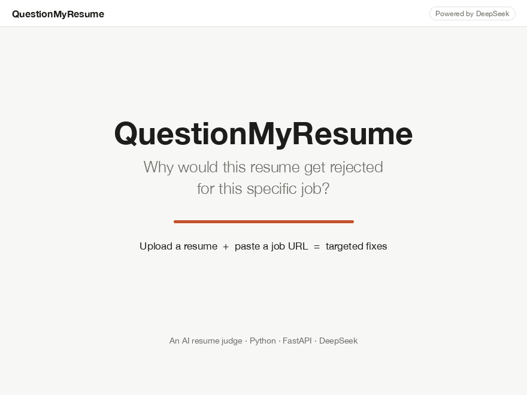
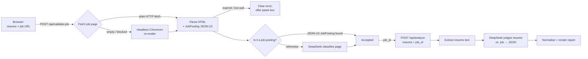

# QuestionMyResume

**Find out why your resume would be rejected for one specific job, and how to fix it.**

Live app: **https://questionmyresume-production.up.railway.app**



Most resume feedback is generic: "add metrics", "use action verbs". Generic critique gets you generic fixes.
QuestionMyResume compares your resume against **one real job posting** and tells you exactly where you fall short
for *that* role, the way a blunt recruiter screening hundreds of applications would.

---

## Table of contents

- [What it does](#what-it-does)
- [How it works](#how-it-works)
- [Tech stack](#tech-stack)
- [Project structure](#project-structure)
- [Running it locally](#running-it-locally)
- [Configuration](#configuration)
- [API reference](#api-reference)
- [Deployment (Railway)](#deployment-railway)
- [Testing](#testing)
- [Design decisions](#design-decisions)
- [Limitations & troubleshooting](#limitations--troubleshooting)
- [Security & privacy](#security--privacy)
- [Ideas for the future](#ideas-for-the-future)

---

## What it does

You give the app two inputs:

1. **Your resume**: PDF, TXT, DOC or DOCX, up to 5 MB.
2. **A job posting URL**, or the job description pasted as text if the site can't be read.

The app first **checks that the URL really is a single, live job posting**. It rejects search results, careers
home pages, expired ads and bot-check pages. Then it **judges your resume against that role** and returns one
full report (not a chat):

| Section | What you get |
|---|---|
| **Match gauge** | Overall match %, shown as a ring: green ≥ 75%, amber 50–74%, red < 50%. Comes with a short verdict on your chances. |
| **Scorecard** | Progress bars for overall resume quality, skills match, experience relevance, keywords / ATS, and impact & metrics, each with a one-line comment. |
| **Top 3 reasons you'd be rejected** | Each reason shows *what the job asks for* next to *what your resume shows*, plus a specific fix. |
| **3 rewritten bullets** | Bullets that sound impressive but add little for this role, rewritten to be specific, quantified and aligned to the posting. Shows before and after, with a Copy button. Never invents experience; unknown numbers appear as placeholders like `[X%]`. |
| **Missing keywords** | Terms from the posting that an applicant-tracking system (ATS) will look for and your resume lacks. |
| **What's already working** | Strengths to keep. |

---

## How it works



### Step 1: Validate the job posting (`/api/validate-job`)

1. **URL checks.** The URL must start with `http://` or `https://`, and it may not point to localhost or a private
   network address. Redirects are checked the same way.
2. **Fetch.** The page is downloaded with a normal browser User-Agent.
3. **Fallback render.** If the page comes back empty (built by JavaScript), blocked (401/403/429), or as a bot-check
   page, it's loaded again in a headless Chromium browser via Playwright.
4. **Detect dead ends.** Closed postings ("This job is no longer advertised…") and anti-bot pages (Cloudflare,
   Akamai, DataDome…) get a clear message. If the page can't be read, the frontend opens a
   **"paste the job description"** box.
5. **Classify.**
   - If the page includes [schema.org `JobPosting`](https://schema.org/JobPosting) data, as most hiring platforms do
     (Greenhouse, Lever, Workday…), it's accepted immediately, with no AI call.
   - Otherwise DeepSeek reads the page text and decides whether it describes one specific open role.
6. The validated page is cached in memory for an hour under a random `job_id`, so step 2 doesn't download it again.

### Step 2: Judge the resume (`/api/analyze`)

1. **File checks.** The file's extension must be one of the four allowed types, and its first bytes must match it
   (a `.png` renamed to `.pdf` is rejected).
2. **Extract text.** `pypdf` for PDF, `python-docx` for DOCX (including tables, which many templates use),
   `antiword`/`textutil` for legacy DOC, and a text decoder for TXT.
3. **Judge.** One DeepSeek call with a detailed recruiter prompt (`app/prompts.py`) returns a strict JSON report.
4. **Normalise.** The response is cleaned up before rendering: scores are clamped to 0–100, lists are trimmed to 3
   items, and missing fields are filled in, so a slightly off-format reply can't break the page.

---

## Tech stack

| Layer | Choice | Why |
|---|---|---|
| Backend | **Python 3.12 + FastAPI** | Async, simple, automatic request validation |
| AI model | **DeepSeek `deepseek-chat`** via the OpenAI-compatible SDK | Low cost, good reasoning, supports JSON output |
| Job page fetching | `httpx`, `beautifulsoup4`, **Playwright** (headless Chromium fallback) | Fast path for normal pages, real browser for JavaScript-heavy ones |
| Resume parsing | `pypdf`, `python-docx`, `antiword` | Covers PDF, DOCX and legacy DOC |
| Frontend | Plain **HTML + CSS + JavaScript** (no build step) | Served by FastAPI; one page, easy to change |
| Hosting | **Railway** (Docker) | One-command deploys from the CLI |

---

## Project structure

```
questionmyresume/
├── app/
│   ├── main.py            FastAPI app: the two API routes + serves the frontend
│   ├── config.py          Settings from environment variables (.env locally)
│   ├── job_fetcher.py     URL safety checks, fetch, headless-browser fallback,
│   │                      JSON-LD extraction, expired / bot-wall detection
│   ├── resume_parser.py   PDF / TXT / DOC / DOCX → plain text, file-type checks
│   ├── llm.py             DeepSeek client, job classification, resume judgement,
│   │                      response normalisation
│   ├── prompts.py         The system prompts and JSON shape the model must return
│   └── static/
│       ├── index.html     The single page: upload form, progress, results
│       ├── styles.css     Theme (warm neutral palette, light + dark mode)
│       └── app.js         Form handling, API calls, report rendering
├── tests/                 pytest suite (parsers, fetcher, normalisation)
├── Dockerfile             Production image (Python 3.12 + Chromium + antiword)
├── requirements.txt       Python dependencies
├── docs/                  Demo GIF
├── .gitignore / .dockerignore / .railwayignore   All exclude .env files
└── README.md
```

**Where to start reading:** `app/main.py` (about 90 lines) shows the whole request flow. To change *what the AI says*,
edit `app/prompts.py`. To change *how it looks*, edit `app/static/`.

---

## Running it locally

**Prerequisites:** Python 3.11+ and a [DeepSeek API key](https://platform.deepseek.com/).

```bash
# 1. Create a virtual environment and install dependencies
python3.12 -m venv .venv
.venv/bin/pip install -r requirements.txt

# 2. Install the headless browser used for JavaScript-heavy job sites (~100 MB, one time)
.venv/bin/playwright install chromium

# 3. Add your DeepSeek key: create a file named .env in the project root containing
#    DEEPSEEK_API_KEY=sk-...
#    (.env is git-ignored and never committed)

# 4. Start the server (auto-reloads when you edit code)
.venv/bin/uvicorn app.main:app --reload
```

Open **http://localhost:8000**.

> Legacy `.doc` files: on macOS the built-in `textutil` handles them. On Linux, install `antiword`
> (`apt install antiword`). The Docker image already includes it.

---

## Configuration

All settings come from environment variables. Locally they're read from `.env`, which is **never committed or
deployed**.

| Variable | Required | Default | Purpose |
|---|---|---|---|
| `DEEPSEEK_API_KEY` | **Yes** | – | Your DeepSeek API key |
| `DEEPSEEK_MODEL` | No | `deepseek-chat` | Model name |
| `DEEPSEEK_BASE_URL` | No | `https://api.deepseek.com` | API endpoint |
| `PORT` | No | `8000` | Port to listen on (set automatically by Railway) |

Limits live in `app/config.py`: 5 MB upload size, and resume and job text truncated to 20k and 15k characters
before they're sent to the model.

---

## API reference

The frontend uses two JSON endpoints. You can also call them directly, for example from a script.

### `POST /api/validate-job`

Request body (JSON). Send a `url`, or a `description` (the pasted posting text, at least 200 characters):

```json
{ "url": "https://job-boards.greenhouse.io/acme/jobs/123", "description": "" }
```

Responses:

```jsonc
// 200: it's a job posting
{ "valid": true, "job_id": "a9b8…", "job_title": "Senior Data Engineer", "company": "Acme", "reason": "…" }

// 200: reachable, but not a job posting (search results, homepage, …)
{ "valid": false, "reason": "This is a job search results list, not a single job posting." }

// 422: couldn't use the page
{ "detail": { "message": "This job posting has expired…", "code": "expired" } }
```

| `code` | Meaning | What the frontend does |
|---|---|---|
| `unreadable` | Login wall, bot check, or no readable text | Opens the paste-description box |
| `expired` | The posting is closed | Shows the message |
| `fetch_failed` | Bad URL, 404, timeout, private address… | Shows the message |

### `POST /api/analyze`

Multipart form with `resume` (the file) and `job_id` (from the step above).

```bash
curl -F resume=@my_resume.pdf -F job_id=a9b8… http://localhost:8000/api/analyze
```

Returns the report:

```jsonc
{
  "job_title": "Senior Data Engineer",
  "company": "Acme",
  "overall_match": 62,          // 0–100
  "resume_quality": 70,         // 0–100
  "verdict": "…",
  "category_scores":   [{ "name": "Skills match", "score": 55, "comment": "…" }, …],
  "rejection_reasons": [{ "title": "…", "job_requires": "…", "resume_shows": "…", "fix": "…" }, …],  // 3 items
  "rewritten_bullets": [{ "original": "…", "rewritten": "…", "why": "…" }, …],                     // 3 items
  "missing_keywords":  ["Airflow", "dbt"],
  "strengths":         ["…"]
}
```

Errors: `415` wrong file type, `413` file too large, `404` `job_id` expired (validate again), `422` the resume
couldn't be read, `502` DeepSeek error.

Interactive API docs are generated automatically at **`/docs`**.

---

## Deployment (Railway)

The app runs on [Railway](https://railway.com) from the `Dockerfile`. Deploys upload this folder directly, so no
Git repo is needed. `.env` is excluded through `.railwayignore`.

```bash
# One-time setup (already done for the live app)
railway init --name questionmyresume
railway add --service questionmyresume
railway variables --set "DEEPSEEK_API_KEY=sk-..."   # the secret lives in Railway, not in the code
railway domain                                        # generates the public URL

# Deploy (run this after every change)
railway up

# Useful
railway logs            # live server logs
railway open            # open the Railway dashboard
```

The Docker image is based on `python:3.12-slim` and adds Playwright's Chromium (with its system libraries) and
`antiword`. Any host that runs a Dockerfile and sets `PORT` will work, for example Render, Fly.io or Cloud Run.

---

## Testing

```bash
.venv/bin/pytest
```

The suite covers:
- **Resume parsing:** each allowed format, extension checks, renamed files, files with too little text.
- **Job page parsing:** `JobPosting` data extraction, refusing private addresses, and detecting expired and
  bot-check pages.
- **Report normalisation:** score clamping, trimming lists to 3 items, filling missing fields.

The tests don't call DeepSeek or need an API key.

---

## Design decisions

- **Two steps, not one.** The job URL is validated before the resume is judged, so you learn quickly (and cheaply)
  if the link is bad, and the progress panel can show which step is running.
- **Structured data first.** If a page includes `JobPosting` data, it's trusted without an AI call. That's faster,
  free, and deterministic.
- **JSON-only model output, then normalisation.** The prompt fixes an exact JSON shape, the API's JSON mode
  enforces it, and `normalize_judgement()` cleans whatever comes back. The frontend never has to guess.
- **Honest by design.** The prompt tells the model to score like a real screener, to cite the posting and the
  resume for every point, and never to invent experience.
- **No database.** Nothing is stored. Resumes are processed in memory and dropped, and validated jobs expire from
  memory after an hour.
- **No frontend framework.** One HTML file, one CSS file and one JS file. Anyone can open and change them without a
  build toolchain.

---

## Limitations & troubleshooting

| Symptom | Cause | What to do |
|---|---|---|
| *"This job site blocks automated access from our server"* | Some boards, **SEEK** and **LinkedIn** included, block requests from cloud servers with bot checks. (SEEK works when the app runs on your own machine.) | Paste the job description into the box that appears, or use the company's own careers-page link. |
| *"This job posting has expired or been closed"* | The ad is no longer live (SEEK keeps expired ads for 30 days). | Use a job that's currently advertised. |
| *"This is a job search results list…"* | You linked a list of jobs, not one job. | Open the specific job and copy that URL. |
| *"Couldn't find enough text in the resume"* | Scanned or image-only PDF. | Export the resume as a text-based PDF or DOCX. |
| *"The job posting session expired"* | More than an hour passed between the two steps, or the server restarted. | Click **Judge my resume** again. |
| *"DEEPSEEK_API_KEY is not set"* | Missing key. | Add it to `.env` (local) or `railway variables` (hosted). |

Results come from an AI model, so wording and scores can vary a little between runs. Treat them as a sharp second
opinion, not a verdict.

---

## Security & privacy

- **Secrets:** the API key is only read from the environment, and `.env` is excluded from Git, Docker and Railway
  uploads.
- **Private network protection:** the server refuses to fetch localhost or private addresses, including through
  redirects and in the headless browser. This stops the job-URL box being used to probe internal networks.
- **Upload safety:** only four extensions are accepted, the file's contents must match its extension, the size is
  capped at 5 MB, and the page inserts text safely so no AI output is injected as HTML.
- **Privacy:** resumes aren't saved to disk or a database. The resume text *is* sent to DeepSeek's API for analysis;
  check DeepSeek's data and privacy terms on [deepseek.com](https://www.deepseek.com/).
- **Cost:** the public URL has no login or rate limit, so anyone with the link spends your DeepSeek credits. Add a
  per-IP rate limit or a simple password if you share it widely.

---

## Ideas for the future

- Download the report as a PDF
- Per-IP rate limiting / optional access password
- Side-by-side "before vs. after" score when you re-upload an improved resume
- Rewrite the whole resume section by section for the target role
- Cover letter generated from the identified gaps
